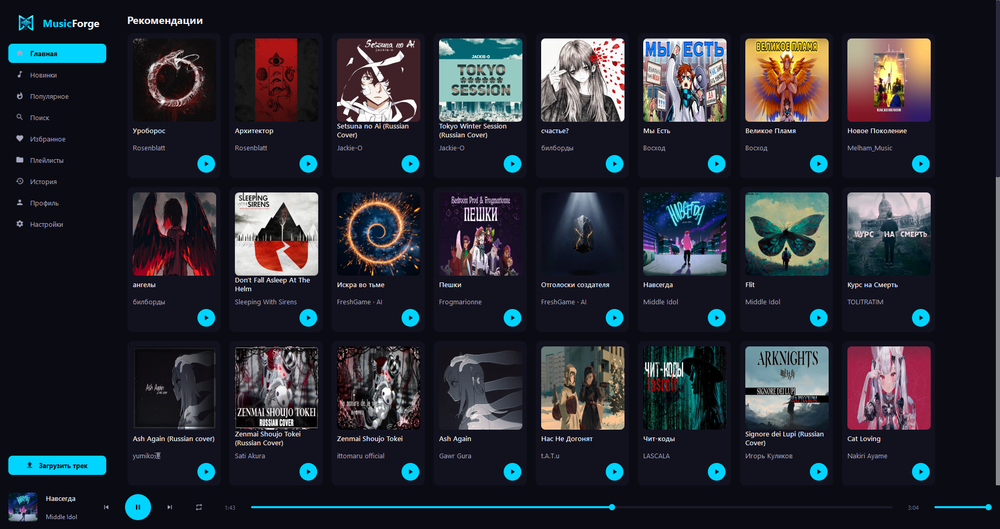

# MusicForge Desktop

Кроссплатформенный десктопный клиент для вашего собственного музыкального сервера **MusicForge**. Написан на Python с использованием фреймворка PySide6 (Qt).



## Основные возможности

- **Мультисерверность и мультиаккаунт**: Поддержка неограниченного количества серверов и аккаунтов. Быстрое переключение без необходимости повторного ввода пароля.
- **Интеграция с Discord**: 
- **Локализация (i18n)**: Полная поддержка русского и английского языков с возможностью переключения «на лету» прямо в настройках.
- **Современный UI**: Темная неоновая тема, адаптивные сетки, кастомные иконки и плавные анимации.
- **Загрузка музыки**: Загрузка локальных аудиофайлов и импорт треков напрямую с YouTube.
- **Плейлисты и избранное**: Полноценное управление личной медиатекой.

## Установка и запуск

Установка библиотек:
```
pip install -r requirements.txt
```

Сборка
```bash
pip install pyinstaller
pyinstaller build.spec
```

## Структура проекта

```
├── core/               # Логика (API-клиент, локализация)
├── langs/              # Файлы переводов (ru_RU.json, en_US.json)
├── src/                # Исходный код интерфейса (PySide6)
│   ├── pages/          # Экраны приложения (Главная, Поиск, Настройки и т.д.)
│   ├── widgets.py      # Кастомные UI-компоненты
│   ├── discord_rpc.py  # Интеграция с Discord
│   └── ...
├── main.py             # Точка входа в приложение
└── requirements.txt    # Зависимости
```